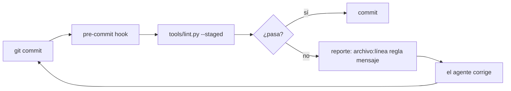

# open-coders-teachers

Cinco carpetas de enseñanza, cada una con el linter de su
ecosistema y **un solo runner** que convierte el lint en retroalimentación
determinista para agentes de IA.


> El problema no es que la IA escriba código rápido. Es que lo escribe con
> variables muertas, funciones de 200 líneas, cinco parámetros, nombres
> inventados y estilos duplicados. Aquí cada uno de esos defectos es un error
> que se ve antes del commit.

## Arranque rápido

```powershell
git clone https://github.com/jdsalasca/open-coders-teachers.git
cd open-coders-teachers
pwsh tools/setup.ps1          # instala dependencias y activa el hook
python tools/lint.py          # revisa todo
```

`tools/setup.ps1` hace tres cosas: activa `.githooks/pre-commit`,
`npm install` en las dos carpetas de Node y compila el proyecto Maven una vez
para cachear los plugins.

## Cómo funciona



Un único punto de entrada, `tools/lint.py`, detecta el lenguaje por carpeta y
extension, y ejecuta lo que corresponda:

| Comando | Qué hace |
|---|---|
| `python tools/lint.py` | revisa todo el repo (incluye archivos sin trackear) |
| `python tools/lint.py --fix` | aplica arreglos automáticos y vuelve a revisar |
| `python tools/lint.py --staged` | solo lo que está en el índice (lo usa el hook) |
| `python tools/lint.py React-teacher` | una carpeta |
| `python tools/lint.py src/App.tsx` | un archivo |

Códigos de salida: `0` limpio, `1` problemas, `2` falta una herramienta.

## Estructura

```
open-coders-teachers/
├── python-teacher/      ruff + mypy           pyproject.toml
├── typescript-teacher/  ESLint 10 + tsc       eslint.config.js, tsconfig.json
├── React-teacher/       ESLint + Stylelint    eslint.config.js, stylelint.config.js, knip.json
├── go-teacher/          golangci-lint         .golangci.yml
├── Java-teacher/        Checkstyle + Spotless pom.xml, config/checkstyle/
├── tools/
│   ├── lint.py          runner único
│   ├── test_lint.py     autochequeo del runner
│   └── setup.ps1        instalación en un clon nuevo
├── .githooks/           hook de pre-commit
└── AGENTS.md            contrato que siguen los agentes
```

## Qué caza cada carpeta

| Defecto típico de la IA | Python | TypeScript | React | Go | Java |
|---|---|---|---|---|---|
| Imports / variables sin usar | ruff `F` | `no-unused-vars` | `no-unused-vars` | `unused`, `unparam` | `UnusedImports`, `UnusedLocalVariable` |
| Función demasiado larga | `PLR0915` | `max-lines-per-function` | `max-lines-per-function` | `funlen` | `MethodLength` |
| Demasiados parámetros | `PLR0913` | `max-params` | `max-params` | `revive argument-limit` | `ParameterNumber` |
| Nombres malos | ruff `N` | `naming-convention` | `naming-convention` | `revive var-naming` | `TypeName`, `MethodName`, … |
| Sin documentación | ruff `D` | `jsdoc/require-jsdoc` | `jsdoc/require-jsdoc` | `revive exported` | `MissingJavadoc*` |
| Orden de miembros | — | `member-ordering` | `member-ordering` | — | `DeclarationOrder` |
| Indentación | `ruff format` | Prettier | Prettier | `gofmt` | Spotless |
| Código duplicado | — | — | Stylelint | `dupl` | — |
| Estilos duplicados | — | — | Stylelint | — | — |
| Dependencias muertas | — | — | `knip` | — | — |
| Promesas sin `await` | — | `no-floating-promises` | `no-floating-promises` | — | — |
| Tipos | `mypy` | `tsc` | `tsc` | compilador | compilador |

## Salida real

```
== python (1 archivo(s)) ==
app.py:1:8: F401 [*] `os` imported but unused
app.py:5:5: PLR0913 Too many arguments in function definition (5 > 4)
app.py:5:5: D103 Missing docstring in public function
app.py:6:5: F841 Local variable `unused` is assigned to but never used
  con problemas
```

```
== react (10 archivo(s)) ==
  ok

== go (1 archivo(s)) ==
main.go:8:1: argument-limit: maximum number of arguments per function exceeded; max 4 but got 5 (revive)
main.go:54:1: File is not properly formatted (gofmt)
  con problemas

Problemas de lint. Arreglo automatico: python tools/lint.py --fix
```

## Vista del proyecto React


## Reglas de React (SCSS)

- Estilos **solo** en `.scss` modules: un `.css` en `React-teacher` es error.
- `style={{ ... }}` está prohibido por ESLint.
- `declaration-block-no-duplicate-properties`, `no-duplicate-selectors` y
  `shorthand-property-no-redundant-values` cazan estilos repetidos.
- `@use` en lugar de `@import`; tokens centralizados en `src/styles/_tokens.scss`.
- `knip` falla con dependencias sin usar o imports no declarados.

## Requisitos

| Herramienta | Instalación |
|---|---|
| Python 3.13 + `ruff` + `mypy` | `uv tool install ruff mypy` |
| Node 24+ | `winget install OpenJS.NodeJS.LTS` |
| Go 1.27 + `golangci-lint` | `winget install GoLang.Go` / `winget install GolangCI.golangci-lint` |
| Java 25 + Maven | `winget install EclipseAdoptium.Temurin.25.JDK` / `winget install Apache.Maven` |

## Añadir un lenguaje

1. Crea la carpeta con su config de lint.
2. Agrega un `Lang(...)` en `tools/lint.py` con sus comandos `check` y `fix`.
3. Escribe su `AGENTS.md` con los límites.
4. `python tools/test_lint.py` y `python tools/lint.py`.

## Notas

- El hook se activa con `git config core.hooksPath .githooks`; `setup.ps1` lo
  hace por ti.
- `--no-verify` está prohibido por el contrato: si el linter tiene razón, se
  arregla el código.
- React usa ESLint 9 porque `eslint-plugin-react` aún no soporta ESLint 10.
  No unifiques versiones sin revisar los peer deps.

## Licencia

MIT.
