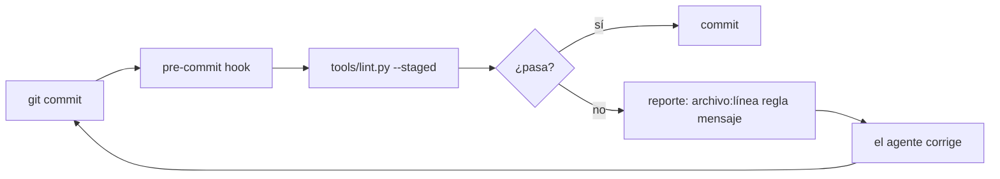
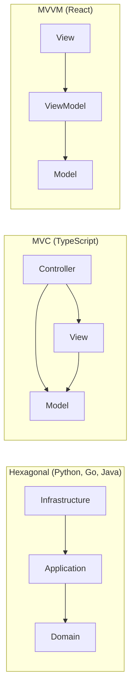

# open-coders-teachers

Cinco carpetas de enseñanza, cada una con el linter de su ecosistema y **un solo
runner** que convierte el lint en retroalimentación determinista para agentes de
IA.


> El problema no es que la IA escriba código rápido. Es que lo escribe con
> variables muertas, funciones de 200 líneas, cinco parámetros, nombres
> inventados, estilos duplicados y capas rotas. Aquí cada uno de esos defectos
> es un error que se ve antes del commit.

## Arranque rápido

```powershell
git clone https://github.com/jdsalasca/open-coders-teachers.git
cd open-coders-teachers
pwsh tools/setup.ps1          # instala dependencias y activa el hook
python tools/lint.py          # revisa todo
python tools/lint.py --audit  # vulnerabilidades en dependencias
```

`tools/setup.ps1` activa `.githooks/pre-commit`, hace `npm install` en las dos
carpetas de Node y compila el proyecto Maven una vez para cachear los plugins.

## Cómo funciona



Un único punto de entrada, `tools/lint.py`, detecta el lenguaje por carpeta y
extensión, y ejecuta lo que corresponda:

| Comando | Qué hace |
|---|---|
| `python tools/lint.py` | revisa todo el repo (incluye archivos sin trackear) |
| `python tools/lint.py --fix` | aplica arreglos automáticos y vuelve a revisar |
| `python tools/lint.py --staged` | solo lo que está en el índice (lo usa el hook) |
| `python tools/lint.py --audit` | vulnerabilidades conocidas en dependencias |
| `python tools/lint.py React-teacher` | una carpeta |
| `python tools/lint.py src/App.tsx` | un archivo |

Códigos de salida: `0` limpio, `1` problemas, `2` falta una herramienta.

## Estructura

```
open-coders-teachers/
├── python-teacher/      ruff + mypy + import-linter      hexagonal
├── typescript-teacher/  ESLint 10 + tsc + depcruise      MVC
├── React-teacher/       ESLint + Stylelint + knip        MVVM
├── go-teacher/          golangci-lint + depguard         hexagonal
├── Java-teacher/        Checkstyle + Spotless + ArchUnit hexagonal
├── tools/
│   ├── lint.py          runner único
│   ├── test_lint.py     autochequeo del runner
│   └── setup.ps1        instalación en un clon nuevo
├── resources/
│   └── antipatterns/    catálogo: síntoma, arreglo y regla que lo caza
├── .githooks/           hook de pre-commit
└── AGENTS.md            contrato que siguen los agentes
```

## Arquitectura por capas

Cada carpeta demuestra una arquitectura y **la hace cumplir**. Si el agente
importa hacia el lado equivocado, el commit falla.



| Carpeta | Capas | Herramienta | Regla |
|---|---|---|---|
| `python-teacher` | `domain` ← `application` ← `infrastructure` | `import-linter` | `pyproject.toml` |
| `go-teacher` | `internal/domain` ← `internal/app` ← `internal/adapters` | `depguard` | `.golangci.yml` |
| `Java-teacher` | `domain` ← `application` ← `infrastructure` | ArchUnit | `ArchitectureTest` |
| `typescript-teacher` | `model` ← `view`, `controller` → ambos | `dependency-cruiser` | `.dependency-cruiser.js` |
| `React-teacher` | `model` ← `viewmodel` ← `view` | `dependency-cruiser` | `.dependency-cruiser.js` |

La infraestructura implementa puertos del dominio; el composition root
(`main.go`, `Main.java`, `main.ts`, `main.tsx`) es la única pieza que conoce
todas las capas.

## Qué caza cada carpeta

| Defecto típico de la IA | Python | TypeScript | React | Go | Java |
|---|---|---|---|---|---|
| Imports / variables sin usar | ruff `F` | `no-unused-vars` | `no-unused-vars` | `unused`, `unparam` | `UnusedImports`, `UnusedLocalVariable` |
| Función demasiado larga | `PLR0915` | `max-lines-per-function` | `max-lines-per-function` | `funlen` | `MethodLength` |
| Demasiados parámetros | `PLR0913` | `max-params` | `max-params` | `revive argument-limit` | `ParameterNumber` |
| Nombres malos | ruff `N` | `naming-convention` | `naming-convention` | `revive var-naming` | `TypeName`, `MethodName`, … |
| Sin documentación | ruff `D` | `jsdoc/require-jsdoc` | `jsdoc/require-jsdoc` | `revive exported` | `MissingJavadoc*` |
| Orden de miembros | — | `member-ordering` | `member-ordering` | — | `DeclarationOrder` |
| Anidamiento profundo | `C901` | `max-depth` | `max-depth` | `cyclop` | `NestedIfDepth` |
| Código duplicado | — | — | Stylelint | `dupl` | — |
| Estilos duplicados | — | — | Stylelint | — | — |
| Rompe capas | `import-linter` | `dependency-cruiser` | `dependency-cruiser` | `depguard` | ArchUnit |
| Dependencias circulares | — | `dependency-cruiser` | `dependency-cruiser` | compilador | compilador |
| Dependencias muertas | — | — | `knip` | — | — |
| Vulnerabilidades (código) | ruff `S` | ESLint | ESLint | `gosec` | `IllegalCatch` |
| Vulnerabilidades (deps) | `pip-audit` | `npm audit` | `npm audit` | `govulncheck` | OWASP (manual) |
| Promesas sin `await` | — | `no-floating-promises` | `no-floating-promises` | — | — |
| Tipos | `mypy` | `tsc` | `tsc` | compilador | compilador |
| Indentación | `ruff format` | Prettier | Prettier | `gofmt` | Spotless |

## Antipatrones

El catálogo vive en [`resources/antipatterns/`](resources/antipatterns/README.md):
síntoma, por qué duele, cómo se arregla y **qué regla lo bloquea**. Los que no
se pueden automatizar están marcados como *manual* para que la revisión humana
sepa dónde mirar.

- [`code.md`](resources/antipatterns/code.md): método largo, banderas
  booleanas, números mágicos, duplicación, clases todopoderosas.
- [`architecture.md`](resources/antipatterns/architecture.md): violación de
  capas, ciclos, dominio anémico, service locator.
- [`frontend.md`](resources/antipatterns/frontend.md): estilos inline,
  duplicados, `useEffect` para estado derivado, índice como key.

## Reglas de React (SCSS)

- Estilos **solo** en `.scss` modules: un `.css` en `React-teacher` es error.
- `style={{ ... }}` está prohibido por ESLint.
- `declaration-block-no-duplicate-properties`, `no-duplicate-selectors` y
  `shorthand-property-no-redundant-values` cazan estilos repetidos.
- `@use` en lugar de `@import`; tokens centralizados en `src/styles/_tokens.scss`.
- `knip` falla con dependencias sin usar o imports no declarados.
- La vista no importa el modelo: consume el viewmodel (`src/viewmodel/`).

## Vista del proyecto React


## Requisitos

| Herramienta | Instalación |
|---|---|
| Python 3.13 + `ruff`, `mypy`, `import-linter`, `pip-audit` | `uv tool install ruff mypy import-linter pip-audit` |
| Node 24+ | `winget install OpenJS.NodeJS.LTS` |
| Go 1.27 + `golangci-lint` + `govulncheck` | `winget install GoLang.Go` / `winget install GolangCI.golangci-lint` / `go install golang.org/x/vuln/cmd/govulncheck@latest` |
| Java 25 + Maven | `winget install EclipseAdoptium.Temurin.25.JDK` / `winget install Apache.Maven` |

## Añadir un lenguaje

1. Crea la carpeta con su config de lint.
2. Agrega un `Lang(...)` en `tools/lint.py` con sus comandos `check` y `fix`.
3. Escribe su `AGENTS.md` con los límites y la arquitectura.
4. `python tools/test_lint.py` y `python tools/lint.py`.

## Notas

- El hook se activa con `git config core.hooksPath .githooks`; `setup.ps1` lo
  hace por ti.
- `--no-verify` está prohibido por el contrato: si el linter tiene razón, se
  arregla el código.
- React usa ESLint 9 porque `eslint-plugin-react` aún no soporta ESLint 10.
  No unifiques versiones sin revisar los peer deps.
- `--audit` requiere red. No corre en el hook: es una revisión periódica.

## Licencia

MIT.
