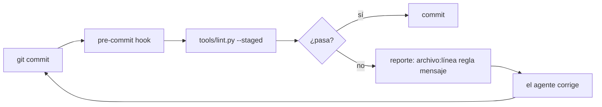
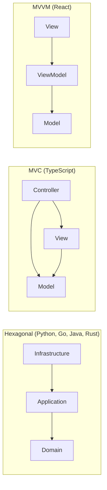
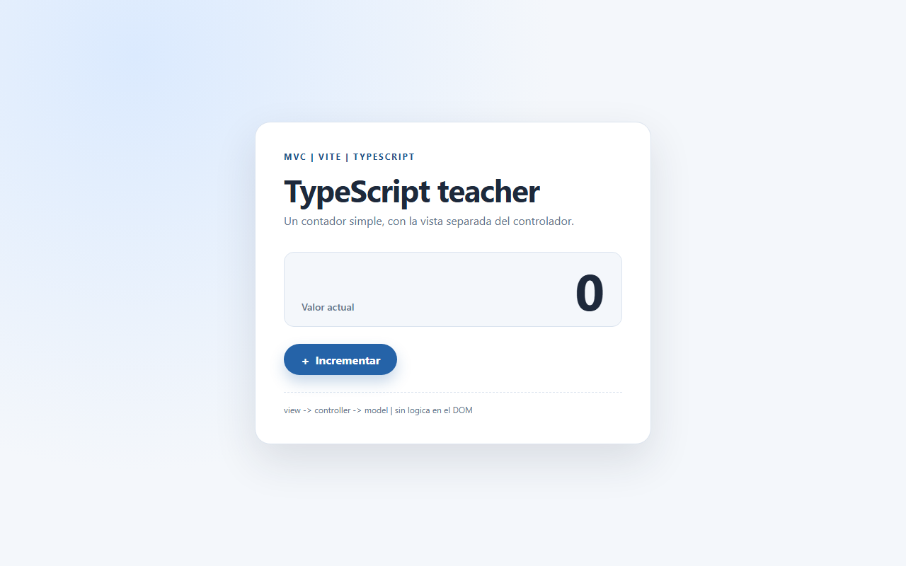
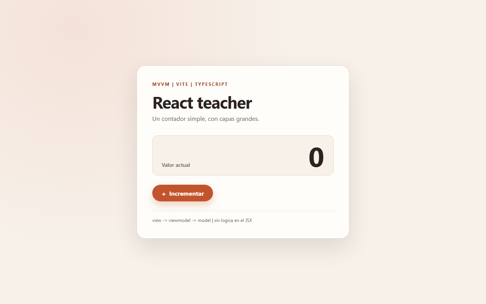
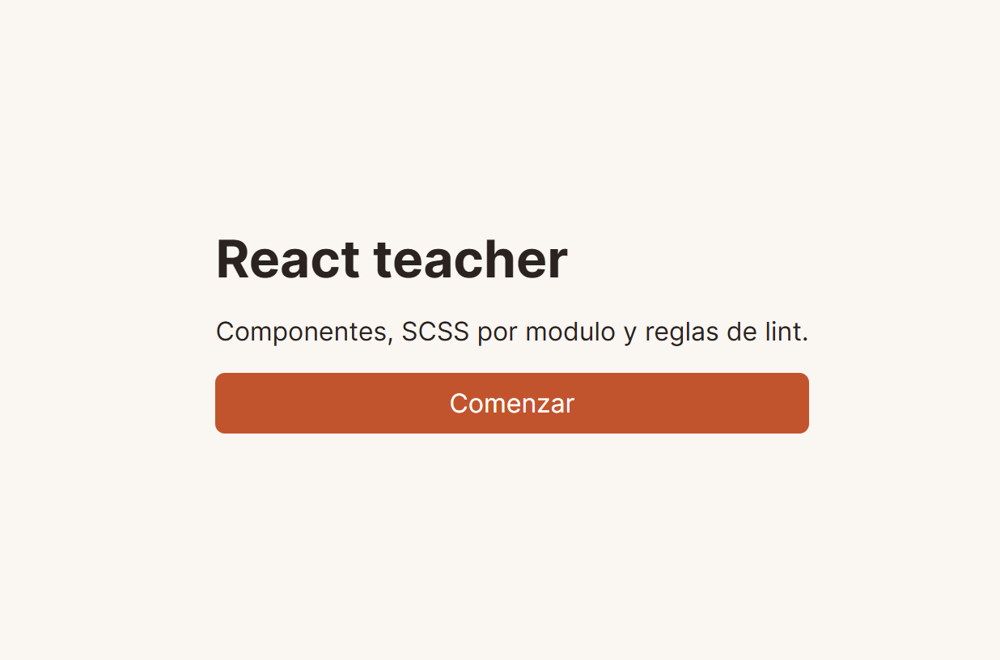

# open-coders-teachers

Seis carpetas de enseñanza, cada una con el linter de su ecosistema y **un solo
runner** que convierte el lint en retroalimentación determinista para agentes de
IA.


[](https://github.com/jdsalasca/open-coders-teachers/actions/workflows/ci.yml)

> El problema no es que la IA escriba código rápido. Es que lo escribe con
> variables muertas, funciones de 200 líneas, cinco parámetros, nombres
> inventados, estilos duplicados y capas rotas. Aquí cada uno de esos defectos
> es un error que se ve antes del commit.

## Arranque rápido

```powershell
git clone https://github.com/jdsalasca/open-coders-teachers.git
cd open-coders-teachers
pwsh tools/setup.ps1          # instala dependencias y activa el hook
python tools/lint.py          # revisa todo
python tools/lint.py --audit  # vulnerabilidades en dependencias
```

`tools/setup.ps1` activa `.githooks/pre-commit`, hace `npm install` en las dos
carpetas de Node, compila el proyecto Maven una vez para cachear los plugins y
descarga las dependencias de Rust.

## Cómo funciona



Un único punto de entrada, `tools/lint.py`, detecta el lenguaje por carpeta y
extensión, y ejecuta lo que corresponda:

| Comando | Qué hace |
|---|---|
| `python tools/lint.py` | revisa todo el repo (incluye archivos sin trackear) |
| `python tools/lint.py --fix` | aplica arreglos automáticos y vuelve a revisar |
| `python tools/lint.py --staged` | solo lo que está en el índice (lo usa el hook) |
| `python tools/lint.py --audit` | vulnerabilidades conocidas en dependencias |
| `python tools/lint.py --security` | secretos, patrones inseguros y dependencias |
| `python tools/lint.py --skip "motivo"` | permite el próximo commit sin linters (un solo uso) |
| `python tools/lint.py --fix --unsafe` | arreglos que pueden cambiar comportamiento |
| `python tools/lint.py --project <ruta>` | audita un proyecto externo (manifiesto) |
| `python tools/lint.py --project <ruta> --validate` | reporte externo por archivo y aspecto |
| `python tools/lint.py --fast <archivo>` | solo herramientas de archivo (sin tests ni capas) |
| `python tools/lint.py --json` | salida estructurada para agentes y scripts |
| `python tools/lint.py <ruta> --validate` | reporte determinista por archivo y aspecto |
| `python tools/lint.py <ruta> --validate --json` | el mismo reporte, estructurado |
| `python tools/lint.py <ruta> --validate --fix` | arregla lo determinista y reporta lo que queda |
| `python tools/lint.py --base develop --validate` | solo el diff de la rama contra `develop` |
| `python tools/lint.py --project <ruta> --base develop --validate` | diff de un proyecto externo |
| `python tools/lint.py --mutation` | mutation testing (Stryker TS/React, PIT Java) |
| `python tools/lint.py --unsafe` | con `--fix`: arreglos que cambian comportamiento |
| `python tools/lint.py React-teacher` | una carpeta |
| `python tools/lint.py src/App.tsx` | un archivo |

Códigos de salida: `0` limpio, `1` problemas, `2` falta una herramienta.

## Reporte determinista por archivo

`--validate` no sustituye al gate: normaliza la salida de cada herramienta y la
agrupa por archivo y aspecto. Sirve para que un agente sepa qué corregir sin
leer seis formatos distintos.

```powershell
python tools/lint.py Rust-teacher --validate
python tools/lint.py typescript-teacher/src --validate --json
python tools/lint.py --validate --fix
python tools/lint.py --project C:\ruta\al\proyecto --validate
python tools/lint.py --project C:\ruta\al\proyecto --validate --json
```

Categorías: `calidad`, `capas`, `nombres`, `acoplamiento`, `srp`,
`complejidad`, `imports`, `formato`, `tests` y `cobertura`. Cada violación dice
archivo, línea, regla, herramienta y si es `auto` (la arregla `--fix`) o
`manual`.

La clasificación es determinista, por regla y herramienta, no por heurística de
IA: `naming-convention`, `N802`, `revive` y `TypeName` son `nombres`;
`depcruise`, `depguard`, `lint-imports` y ArchUnit son `capas`;
`complexity`, `cyclop` y `C901` son `complejidad`; `max-lines`, `filelength` y
`ClassFanOutComplexity` son `srp`; `simple-import-sort`, `gci` y
`CustomImportOrder` son `imports`. Lo que una herramienta no expone con archivo
y línea se reporta a nivel de carpeta; no se inventa una ubicación.

### Qué hacer con cada hallazgo

Cada violación lleva además un grupo de **acción**, para leer el reporte en orden
de urgencia y no en orden de archivo:

| Acción | Qué agrupa | Para qué |
| :--- | :--- | :--- |
| `bloqueante` | fallos de herramienta, `bodyclose`, `errcheck`, `gosec`, `SA1012`, `contextcheck` | rompen el build, la seguridad o un contrato |
| `accionable` | imports muertos, Javadoc, complejidad de método, tests faltantes | se corrigen en el PR |
| `patron` | `MethodName`, `VisibilityModifier`, `HiddenField`, `lll`, formato | convención del repo dueño; ruido al revisar código ajeno |
| `deuda` | `FileLength`, `ClassFanOutComplexity`, `MethodCount` | estructura previa; no la introduce el cambio |

**La regla no se oculta: todo sigue visible.** El grupo solo ordena y etiqueta,
así que al revisar otro repo se miran primero los dos primeros y se puede auditar
qué quedó en los otros dos. Lo que no está mapeado cae en `accionable` para que
nadie lo pierda por falta de clasificación.

En texto, el resumen agrega una línea `Accion:`. En `--json`, el encabezado trae
`by_action` y cada violación un campo `action`.

En Java externo, además de Checkstyle/PMD, el reporte exige dominio sin
`jakarta.persistence`, Spring ni Lombok; capas que no apunten hacia
`service → web/repo` ni `web → repo`; DTOs sin imports del dominio; clases
`*Controller` con `@RestController` y `*Service` con `@Service`; inyección por
constructor; mappers en vez de construir DTOs en el servicio; y tests unitarios
para cada servicio. Si el proyecto no es Maven, Checkstyle/PMD no corren y el
reporte lo dice.

En Python, Go, Rust y TypeScript el mismo reporte exige dirección de capas
(`domain` no importa `application`/`infrastructure`/`web`; `application` no
importa infraestructura ni web; `model` no importa vista/controlador/páginas en
frontend; `lib` no importa páginas/componentes), dominio sin frameworks,
DTOs/esquemas sin tipos del dominio, JSDoc en exports de TypeScript y tests
reales: existencia, tamaño, cantidad de casos y al menos una aserción. Rust
además exige `missing_docs`.

En todos los lenguajes, las abstracciones (`*Port`, `*UseCase`, `*Gateway`,
`*Repository`, `*Service`, `*Controller`, `*View`, `*ViewModel`, `*Presenter`,
`*Handler`) deben ser **operacionales**: entre 1 y 4 métodos, con nombre de
verbo, sin interfaces de framework tipo `JpaRepository`. La capa de aplicación
no puede depender de clases concretas de `infrastructure`/`adapters`/`repo`:
Java y TypeScript lo comprueban sobre campos, constructores e imports; Python,
Go y Rust lo imponen con la dirección de capas.

`--fix` aplica solo lo que cada herramienta marca como arreglo seguro:
formateadores, orden de imports, lints con `fix` y `spotless`. Nombres,
complejidad, capas y SRP se reportan como `manual` porque un arreglo automático
podría cambiar el diseño.

## Solo el diff de una rama

`--base <rama>` compara contra el **merge-base** de esa rama y limita el
reporte a los archivos que introduce la rama actual. `--changed` es un alias.

```powershell
python tools/lint.py --base develop --validate
python tools/lint.py --project C:\work\repo --base develop --validate
python tools/lint.py --project C:\work\repo --base develop --validate --json
python tools/lint.py --project C:\work\repo --base develop --validate --fix
```

Sin `--base`, `--project ... --validate` audita **todo** el proyecto. Si el diff
toca un manifiesto o configuración (`Cargo.toml`, `go.mod`, `pom.xml`,
`package.json`, `pyproject.toml`, `tsconfig.json`, etc.), el gate vuelve a
auditar el proyecto completo: un cambio de configuración no se puede validar
mirando solo un archivo. Si no hay cambios, sale `0` con un reporte vacío.

Para el trabajo, el wrapper evita recordar las banderas:

```powershell
pwsh tools/quality.ps1 -Project C:\work\repo -Base develop
pwsh tools/quality.ps1 -Project C:\work\repo -Base develop -Fix -Json
pwsh tools/quality.ps1 -Project C:\work\repo          # proyecto completo
```

En proyectos externos, `--project <ruta> --validate` usa el baseline portable y
aplica las mismas categorías. Rust es el caso más estricto: `cargo fmt` y
clippy con `many_single_char_names`, `too_many_lines`, `cognitive_complexity`,
`too_many_arguments`, repetición de módulo, imports comodín, `unwrap`/`expect`/
`panic` y documentación de errores. Los umbrales viven en
`tools/rust/clippy.toml`: 40 líneas por función, 8 de complejidad y 4
parámetros. Los lints de casts numéricos no entran en el baseline externo para
no ahogar el reporte; el teacher de Rust sí los cubre con `pedantic`.

Con `--staged`, el runner elige las rutas del índice, pero las herramientas leen
el árbol de trabajo; `staged_guard` rechaza archivos con cambios sin stagear. Un
cambio de configuración amplía el alcance al proyecto completo. El hook es una
ayuda: el check obligatorio es CI.

## Testing y TDD

Primero el test que falla, después el código que lo hace pasar. El runner
ejecuta las pruebas de las seis carpetas en cada commit y **falla si la
cobertura baja del mínimo**:

| Carpeta | Runner | Mínimo | Archivo |
|---|---|---|---|
| `python-teacher` | pytest + pytest-cov | 60% | `tests/test_*.py` |
| `typescript-teacher` | vitest + v8 | 80% | `src/**/*.test.ts` |
| `React-teacher` | vitest + v8 + jsdom | 80% | `src/**/*.test.tsx?` |
| `go-teacher` | `go test` + `go tool cover` | 50% | `*_test.go` |
| `Java-teacher` | JUnit 5 + JaCoCo | 60% | `*Test.java` |
| `Rust-teacher` | `cargo llvm-cov` | 60% | `src/**/*.rs`, `tests/*.rs` |

```powershell
cd typescript-teacher; npm run test    # vitest + cobertura
cd React-teacher;       npm run test
cd python-teacher;      pytest --cov=app
cd go-teacher;          go test ./... -cover
cd Java-teacher;        mvn test
cd Rust-teacher;        cargo llvm-cov --fail-under-lines 60
```

En PR, `diff-cover` exige **80% en las líneas nuevas** de Python, Java,
TypeScript, React y Rust (Go aún no exporta lcov). No sustituye el mínimo
global: lo complementa.

El CI también ejecuta `tools/coverage_gate.py`: mínimo **por archivo** de 80%
en TypeScript/React, 60% en Python/Java/Rust y 50% en Go, excluyendo
composition roots y tests.

## Estructura

```text
open-coders-teachers/
├── python-teacher/      ruff + mypy + import-linter + pytest   hexagonal
├── typescript-teacher/  ESLint 10 + tsc + Vite + depcruise + vitest MVC
├── React-teacher/       ESLint + Stylelint + knip + vitest     MVVM
├── go-teacher/          golangci-lint + depguard + HTTP + SQLite   hexagonal
├── Java-teacher/        Checkstyle + Spotless + ArchUnit + JaCoCo hexagonal
├── Rust-teacher/        rustfmt + clippy + cargo-llvm-cov       hexagonal
├── tools/
│   ├── lint.py          entrada compatible del runner
│   ├── lintlib/         core, portable, audit y reporte por archivo
│   ├── test_lint.py     autochequeo del runner
│   ├── quality.ps1      reporte de calidad para un proyecto externo
│   └── setup.ps1        instalación en un clon nuevo
├── resources/
│   └── antipatterns/    catálogo: síntoma, arreglo y regla que lo caza
├── .githooks/           hook de pre-commit
└── AGENTS.md            contrato que siguen los agentes
```

## Arquitectura por capas

Cada carpeta demuestra una arquitectura y **la hace cumplir**. Si el agente
importa hacia el lado equivocado, el commit falla.



| Carpeta | Capas | Herramienta | Regla |
|---|---|---|---|
| `python-teacher` | `domain` ← `application` ← `infrastructure` | `import-linter` | `pyproject.toml` |
| `go-teacher` | `internal/domain` ← `internal/app` ← (`internal/web`, `internal/adapters`) | `depguard` | `.golangci.yml` |
| `Java-teacher` | `domain` ← `application` ← `infrastructure` | ArchUnit | `ArchitectureTest` |
| `Rust-teacher` | `domain` ← `application` ← `infrastructure` | test de capas | `tests/layers.rs` |
| `typescript-teacher` | `model` ← `view`, `controller` → ambos | `dependency-cruiser` | `.dependency-cruiser.js` |
| `React-teacher` | `model` ← `viewmodel` ← `view` | `dependency-cruiser` | `.dependency-cruiser.js` |

La infraestructura implementa puertos del dominio; el composition root
(`main.go`, `Main.java`, `main.ts`, `main.tsx`, `main.rs`) es la única pieza que
conoce todas las capas.

## SOLID y clean code

Cinco reglas que ninguna herramienta del set cubre de forma portable, aplicadas a
los seis lenguajes:

| Regla | Qué detecta | Por qué importa |
| :--- | :--- | :--- |
| `todo-pendiente` | `TODO`, `FIXME`, `XXX`, `HACK` | deuda que entra al código sin que nadie la vea |
| `lsp-no-implementado` | implementación que lanza "no implementado" fuera de una base abstracta | rompe el contrato de su interfaz |
| `srp-dependencias` | constructor con más de 4 dependencias inyectadas | la clase tiene más de una responsabilidad |
| `dominio-util` | el dominio importa `util`/`helpers`/`common` del proyecto | arrastra dependencias que el dominio no debe conocer |
| `capa-ciclo` | dos paquetes que se importan mutuamente | rompe la dirección de capas |

Las cuatro primeras nacen como `accionable`; el ciclo es `capas`: no es estilo,
es arquitectura rota. `dominio-util` y `capa-ciclo` ignoran la biblioteca estándar
(`java.util`, `fmt`, `os`…) para no marcar imports que no son del proyecto, y
`lsp-no-implementado` no reporta una base abstracta, donde declarar el contrato
sin implementarlo es correcto.

Ejemplo en Java:

```java
public class Checkout {
  public Checkout(PriceService a, StockService b, PayService c, MailService d, AuditService e) { }
}
// srp-dependencias: 5 dependencias inyectadas (PriceService, StockService, PayService...);
// la clase probablemente tenga mas de una responsabilidad
```

## Exigencia adicional (Java y Go)

Las dos carpetas con más peso tienen un set ampliado. La idea es que el gate
cace el defecto, no solo el estilo.

### Java

- **PMD** pasa de 7 a 25 reglas: `PreserveStackTrace`, `CloseResource`,
  `SimpleDateFormatNeedsLocale`, `InvalidLogMessageFormat`, `LawOfDemeter`,
  `NPathComplexity`, `CognitiveComplexity`, `GodClass`, `ImmutableField`,
  `LiteralsFirstInComparisons`, `UnusedFormalParameter`, `ReturnEmptyCollectionRatherThanNull`,
  `CompareObjectsWithEquals`, entre otras.
- **Checkstyle** suma `MagicNumber`, `FinalParameters`, `ReturnCount`,
  `ClassDataAbstractionCoupling` y una regla de texto que prohíbe `printStackTrace`
  y las marcas `TODO`/`FIXME`.
- **Diez reglas propias** que ninguna herramienta cubre:
  `transaccional-en-controller`, `entidad-fuera-de-infra`, `pii-en-log`,
  `sleep-en-produccion`, `string-format`, `optional-is-present`, `null-lambda`,
  `serializador-manual`, `doonnext-side-effect` (bloqueante, efecto en un
  operador reactivo) y `mockito-sin-extendwith` (tests con `@Mock` sin
  `@ExtendWith`).

### Go

Seis linters nuevos: `err113` (errores dinámicos), `musttag` (structs JSON sin
tags), `ireturn` (retorno de interfaces), `maintidx` (mantenibilidad),
`forbidigo` (`fmt.Print` en producción) y `nolintlint` (`nolint` sin justificar).

### Lo que se probó y quedó fuera

- **`wrapcheck`**: en un proyecto con errores de dominio tipados obliga a envolver
  lo que se propaga a propósito, y no permite exceptuar paquetes propios.
- **`exhaustruct`**: los structs parciales de builders y tests generan 13 falsos
  positivos sin señal proporcional.

Dejarlos habría inflado el reporte sin cambiar ninguna decisión. La exigencia se
mide por lo que obliga a corregir, no por la cantidad de reglas.

### Nulos y errores, en los seis lenguajes

El mismo defecto tiene otra forma en cada lenguaje, así que la regla es distinta:

| Regla | Lenguaje | Qué caza |
| :--- | :--- | :--- |
| `go-panic` | Go | `panic` fuera del composition root |
| `rust-unwrap` | Rust | `unwrap()` / `expect()` en producción |
| `ts-non-null-assertion` | TS | `x!` apaga `strictNullChecks` |
| `ts-any` | TS | `any` desactiva el tipado |
| `python-none-comparison` | Python | `== None` en vez de `is None` |

El composition root (`main.go`, `main.rs`, `cmd/**`) queda exento: es el borde del
programa y ahí fallar ruidosamente es correcto.

## Mensajes de commit

`.githooks/commit-msg` llama a `tools/commit_msg.py`, sin dependencias externas:

- `tipo(scope): resumen` — tipos: `feat`, `fix`, `docs`, `test`, `refactor`, `perf`,
  `build`, `ci`, `chore`, `revert`.
- Resumen en minúscula, sin punto final, entre 10 y 72 caracteres.
- Si hay cuerpo, explica **el porqué** (mínimo 20 caracteres).
- Prohibido atribuir el cambio a un modelo o asistente (`Co-authored-by` / `Signed-off-by`).

## Así se ve TypeScript-teacher



La vista inyecta la tarjeta y avisa clics; el controlador conecta el modelo y
la vista, sin framework. El dev server es Vite y los estilos viven en SCSS.

## Así se ve React-teacher



La vista solo pinta y avisa clics; el viewmodel guarda el estado. El E2E de
Playwright + axe valida interacción, contraste y accesibilidad.

## Referencia HTTP (Go)

`go-teacher` es el recorrido completo de una petición: HTTP → validación → caso
de uso → SQLite, con paginación e idempotencia. Los otros cinco teachers
conservan ejemplos mínimos; este muestra el patrón sin duplicarlo seis veces.

```powershell
cd go-teacher
$env:TASKS_DB = "tasks.db"
go run ./cmd/api
```

| Método | Ruta | Comportamiento |
|---|---|---|
| `POST` | `/tasks` | `201` nueva, `200` si repite `Idempotency-Key`; `400/413/415` |
| `GET` | `/tasks?limit=20&offset=0` | página con `items`, `limit` y `offset`; límite 1..100 |
| `GET` | `/healthz` | `200 {"status":"ok"}` |

Cuerpo máximo 1 MiB, `Content-Type: application/json`, errores JSON sin filtrar
detalles internos, timeouts y apagado ordenado. Escucha en `127.0.0.1:8080` por
defecto; `TASKS_ADDR` la expone si hace falta. `TASKS_DB` elige la base. Una
página fuera de rango o un UTF-8 inválido devuelven `400`. El adaptador SQLite
usa `modernc.org/sqlite`, WAL, `_txlock=immediate` y una conexión por instancia;
el contrato de `internal/testutil` corre contra memoria y SQLite, incluido el
reinicio y dos instancias sobre el mismo archivo con la misma clave.

## Qué caza cada carpeta

| Defecto típico de la IA | Python | TypeScript | React | Go | Java | Rust |
|---|---|---|---|---|---|---|
| Imports / variables sin usar | ruff `F` | `no-unused-vars` | `no-unused-vars` | `unused`, `unparam` | `UnusedImports`, `UnusedLocalVariable` | `clippy` |
| Función demasiado larga | `PLR0915` | `max-lines-per-function` | `max-lines-per-function` | `funlen` | `MethodLength` | `too_many_lines` |
| Demasiados parámetros | `PLR0913` | `max-params` | `max-params` | `revive argument-limit` | `ParameterNumber` | `too_many_arguments` |
| Nombres malos | ruff `N` | `naming-convention` | `naming-convention` | `revive var-naming` | `TypeName`, `MethodName`, … | `clippy` |
| Sin documentación | ruff `D` | `jsdoc/require-jsdoc` | `jsdoc/require-jsdoc` | `revive exported` | `MissingJavadoc*` | `missing_docs` |
| Orden de miembros | — | `member-ordering` | `member-ordering` | — | `DeclarationOrder` | — |
| Anidamiento profundo | `C901` | `max-depth` | `max-depth` | `cyclop` | `NestedIfDepth` | `cognitive_complexity` |
| Código duplicado | — | `jscpd` | `jscpd` + Stylelint | `dupl` | CPD | — |
| Estilos duplicados | — | — | Stylelint | — | — | — |
| Rompe capas | `import-linter` | `dependency-cruiser` | `dependency-cruiser` | `depguard` | ArchUnit | `tests/layers.rs` |
| Dependencias circulares | — | `dependency-cruiser` | `dependency-cruiser` | compilador | compilador | compilador |
| Dependencias muertas | — | — | `knip` | — | — | `dead_code` |
| Vulnerabilidades (código) | ruff `S` | ESLint | ESLint | `gosec` | `IllegalCatch` | `clippy` + Semgrep |
| Bugs de bytecode | - | - | - | - | SpotBugs | - |
| Vulnerabilidades (deps) | `pip-audit` | `npm audit --omit=dev` | `npm audit --omit=dev` | `govulncheck` | OSV + Dependabot | OSV |
| Sin tests / poca cobertura | pytest-cov | vitest | vitest | `go tool cover` | JaCoCo | `cargo-llvm-cov` |
| Promesas sin `await` | — | `no-floating-promises` | `no-floating-promises` | — | — | — |
| Tipos | `mypy` | `tsc` | `tsc` + sin tipos vagos | compilador | compilador | compilador + `clippy` |
| Código deprecado | — | `no-deprecated` (tipos) | `no-deprecated` (tipos) | `staticcheck` | `-Xlint:all` | compilador `-D warnings` |
| Métodos/campos privados muertos | — | — | — | `unused` | PMD `UnusedPrivate*` | `dead_code` |
| Documentación | markdownlint + enlaces | markdownlint + enlaces | markdownlint + enlaces | markdownlint + enlaces | markdownlint + enlaces | markdownlint + enlaces |
| Nombres de archivo | `ls-lint` | `ls-lint` | `ls-lint` | `ls-lint` | `ls-lint` | `ls-lint` |
| Entidades en la API | — | — | — | — | `web_sin_dominio` (DTOs) | `TaskView` (DTO) |
| Validación de entrada | Pydantic + DTO + invariantes | Zod + `no-unsafe-*` | Zod + `no-unsafe-*` | validator + DTO (200 runas) | Bean Validation (code points) + `Objects.requireNonNull` | `serde` + `validator` |
| IDs únicos | repositorio + lock + test | - | - | repositorio + mutex + test | repositorio + `AtomicInteger` + test | repositorio + mutex + test |
| Indentación | `ruff format` | Prettier | Prettier | `gofmt` | Spotless | `rustfmt` |

## Auditar un proyecto externo

```powershell
python tools/lint.py --project C:\ruta\al\proyecto
python tools/lint.py --project C:\ruta\al\proyecto --fix
python tools/lint.py --project C:\ruta\al\proyecto --validate
python tools/lint.py --project C:\ruta\al\proyecto --validate --json
```

También detecta la ruta externa si se la pasas directo (`python tools/lint.py
C:\ruta`). El modo portable **descubre proyectos por manifiesto y extensión**:
un root con `package.json` y `requirements.txt` se separa en Node y Python; los
crates de un workspace Rust se funden para no repetir clippy.

| Manifiesto | Baseline |
|---|---|
| `package.json` | ESLint + Stylelint + dependency-cruiser + capas + JSDoc + tests |
| `go.mod` | golangci-lint + capas + tests |
| `pyproject.toml`, `requirements.txt` | ruff + capas + tests |
| `pom.xml` | Checkstyle + PMD + analizador de arquitectura/DTO/Spring/tests + Semgrep |
| `build.gradle`, `build.gradle.kts` | Analizador de arquitectura/DTO/Spring/tests + Semgrep (sin Checkstyle/PMD) |
| `Cargo.toml` | `cargo fmt` + clippy de diseño + `missing_docs` + capas + tests |
| `project.godot` | `gdlint` + `gdformat --check` |

Antes, apuntar el runner a un monorepo React devolvía `Nada que revisar` y
salía con 0: solo conocía sus seis carpetas. Ahora, si encuentra archivos pero
ningún manifiesto, **falla con código 2** en vez de fingir que está limpio.

El baseline portable aplica reglas de calidad, no opiniones de estilo:
`no-unused-vars`, `no-explicit-any`, `no-console`, `eqeqeq`, `no-var`,
`prefer-const`, `max-params: 4`, `max-lines-per-function: 40`, `complexity: 8`,
`max-depth: 3`, reglas de React, `eslint-plugin-security`, duplicados de SCSS y
ciclos entre módulos. También reporta fuentes de más de 400 líneas (sin tests
ni generados) y avisa si no encuentra tests, CI o README. Los tests quedan
exentos de los límites de tamaño.

```powershell
python tools/lint.py --project C:\Users\jdsal\Documents\Programming-personal
```

Ese comando audita todos los proyectos del árbol; el resultado puede ser largo,
así que empieza por una carpeta. Para Godot necesitas `gdtoolkit`:
`uv tool install gdtoolkit` (aporta `gdlint` y `gdformat`). Límites conocidos:
no ejecuta `tsc` ni los tests del proyecto externo (necesita sus dependencias);
los tests se revisan de forma estática (existencia, tamaño y aserciones), no se
ejecutan ni se mide cobertura. Java se revisa con Checkstyle, PMD, un analizador
de arquitectura/DTO/tests y Semgrep; Gradle conserva el analizador y Semgrep,
pero no Checkstyle/PMD. Rust se revisa sin ejecutar tests ni cobertura; clippy
exige documentación pública. Godot depende de `gdtoolkit` y su parser puede no
entender sintaxis nueva. No hay escaneo de secretos ni soporte específico de
C/C++, C# o Kotlin. Un resultado `2` significa "no pude verificar", nunca "está
limpio".

## Política propia (Semgrep)

`.semgrep/rules.yml` convierte convenciones del repo en bloqueo: la vista no
llama `fetch`/`axios`, `localStorage` no sale de su capa, `process.env` solo en
el composition root, `System.out` solo en `Main`, y
`print`/`fmt.Print`/`println!` solo en entrypoints. Corre en el gate normal, en
`--security` y en CI. Son patrones concretos: un alias o una API equivalente
puede escapar; la regla no sustituye la revisión.

## Seguridad

```powershell
python tools/lint.py --security   # gitleaks + semgrep + gosec + auditoría de deps
python tools/lint.py --audit      # solo dependencias
```

| Capa | Herramienta | Qué busca |
|---|---|---|
| Secretos | `gitleaks` | claves, tokens y credenciales filtradas |
| Patrones inseguros | `semgrep --config p/ci` | inyección, deserialización, supply-chain en CI |
| Go | `gosec` | crypto débil, path traversal, TLS inseguro |
| Python | `ruff S` (bandit) | `eval`, `subprocess` con shell, secretos |
| Node | `eslint-plugin-security` | `eval`, regex DoS, object injection |
| Rust | `clippy` + Semgrep | `unwrap`/`expect`, `panic`, `unsafe`, prints fuera de `main` |
| Dependencias | `npm audit --omit=dev` (runtime; dev vía Dependabot), `govulncheck`, `pip-audit`, **OSV (Maven, crates.io)** + Dependabot | CVEs conocidas |

Semgrep corre también en CI, y de hecho encontró dos problemas reales en el
propio workflow (actions con tag movible y `curl | sh`): ambos se corrigieron
fijando los SHA y descargando el binario antes de instalarlo.

## Skip de emergencia

Si un agente necesita saltarse el hook, **primero pide permiso al humano** y
explica qué reglas va a permitir y por qué:

```powershell
python tools/lint.py --skip "motivo concreto"
git commit -m "..."    # pasa una vez, con aviso no bloqueante
```

El permiso caduca en 10 minutos, es de un solo uso y queda en
`.git/lint-skip.log`. El aviso recuerda explícitamente que hay que pedir
confirmación humana antes de hacerlo.

## Patrones de diseño

[`resources/patterns/`](resources/patterns/README.md) mapea cada patrón que el
repo enseña (Ports & Adapters, Repository, Composition Root, MVC, MVVM, Contract
Test) a la regla que impide implementarlo mal, y lista los antipatrones que solo
ve un humano.

Un cambio en una config de arquitectura exige un ADR: `tools/check_adr.py` lo
verifica en cada PR.

## Cobertura de los libros

Cada principio de los libros canónicos está mapeado a una regla determinista o
marcado como manual: [`resources/antipatterns/books.md`](resources/antipatterns/books.md).

| Libro | Qué se exige |
|---|---|
| Clean Code | funciones ≤ 40 líneas, ≤ 4 parámetros, complejidad ≤ 8, nombres |
| Refactoring | duplicación, código muerto, clase grande, anidamiento |
| Code Complete | complejidad, anidamiento, alcance de variables, doc por rutina |
| Effective Java | visibilidad, `equals`/`hashCode`, `IllegalCatch`, interfaz pequeña |
| Clean Architecture | regla de dependencias y ciclos en las 6 carpetas |
| Pragmatic Programmer | DRY, secretos, CI bloqueante |
| TDD | test antes del código + cobertura mínima |

## Antipatrones

El catálogo vive en [`resources/antipatterns/`](resources/antipatterns/README.md):
síntoma, por qué duele, cómo se arregla y **qué regla lo bloquea**. Los que no
se pueden automatizar están marcados como *manual* para que la revisión humana
sepa dónde mirar.

- [`code.md`](resources/antipatterns/code.md): método largo, banderas
  booleanas, números mágicos, duplicación, clases todopoderosas.
- [`architecture.md`](resources/antipatterns/architecture.md): violación de
  capas, ciclos, dominio anémico, service locator.
- [`frontend.md`](resources/antipatterns/frontend.md): estilos inline,
  duplicados, `useEffect` para estado derivado, índice como key.
- [`testing.md`](resources/antipatterns/testing.md): tests que no prueban nada,
  orden implícito, mocks de todo, `assert` desactivado.

## Reglas de React (SCSS)

- Estilos **solo** en `.scss` modules: un `.css` en `React-teacher` es error.
- `style={{ ... }}` está prohibido por ESLint.
- `declaration-block-no-duplicate-properties`, `no-duplicate-selectors` y
  `shorthand-property-no-redundant-values` cazan estilos repetidos.
- `@use` en lugar de `@import`; tokens centralizados en `src/styles/_tokens.scss`.
- `knip` falla con dependencias sin usar o imports no declarados.
- La vista no importa el modelo: consume el viewmodel (`src/viewmodel/`).

## Vista del proyecto React



## Requisitos

| Herramienta | Instalación |
|---|---|
| Python 3.13 + `ruff`, `mypy`, `import-linter`, `pytest`, `hypothesis` | `uv tool install ruff mypy import-linter pip-audit` / `pip install pytest pytest-cov hypothesis` |
| Node 24+ | `winget install OpenJS.NodeJS.LTS` |
| Go 1.27 + `golangci-lint` + `govulncheck` | `winget install GoLang.Go` / `winget install GolangCI.golangci-lint` / `go install golang.org/x/vuln/cmd/govulncheck@latest` |
| JDK 25 + Maven (bytecode 21) | `winget install EclipseAdoptium.Temurin.25.JDK` / `winget install Apache.Maven` |
| Rust 1.99 + `cargo-llvm-cov` | `rustup toolchain install 1.99.0` / `cargo install cargo-llvm-cov --locked` |
| `actionlint` (workflows) | `winget install rhysd.actionlint` o `go install github.com/rhysd/actionlint/cmd/actionlint@v1.7.12` |
| `gdtoolkit` (Godot portable) | `uv tool install gdtoolkit` |

El gate también pasa `ruff` sobre `tools/` y `actionlint` sobre
`.github/workflows/`; si falta `actionlint`, el runner devuelve `2`.

## Añadir un lenguaje

1. Crea la carpeta con su config de lint.
2. Agrega un `Lang(...)` en `tools/lintlib/common.py` con sus comandos `check` y `fix`.
3. Escribe su `AGENTS.md` con los límites y la arquitectura.
4. `python tools/test_lint.py` y `python tools/lint.py`.

## Lint en cada edición

`.opencode/plugins/lint-on-edit.ts` engancha `tool.execute.after`: cuando un
agente escribe o edita un archivo dentro de las seis carpetas, corre
`python tools/lint.py --fast <archivo>` y **añade el reporte al resultado de la
herramienta**. El agente ve el problema en el mismo turno, sin esperar al commit.

- `--fast` corre solo lo que entiende de un archivo (ESLint, ruff, Prettier,
  Stylelint, rustfmt/clippy) y omite tests, tipos, capas y cobertura: Python
  ~0.2 s, React ~5 s.
- El commit sigue ejecutando la suite completa; el plugin es feedback temprano,
  no un reemplazo del hook.

## Property tests y E2E

- **Property-based tests** en los seis lenguajes: Hypothesis (Python),
  fast-check (TS/React), `testing/quick` (Go), jqwik (Java) y proptest (Rust).
  No prueban un caso: prueban una propiedad para cientos de entradas.
- **E2E con accesibilidad real**: Playwright + axe-core sobre la app renderizada.
  Un `alt` faltante o un contraste bajo que el linter estático no ve, sí lo ve
  axe.

```powershell
cd React-teacher; npm run e2e          # requiere npx playwright install chromium
cd typescript-teacher; npm run e2e     # misma dependencia
```

## Mutation testing

La cobertura se puede engañar; los mutantes no. Stryker cambia el código a
propósito y comprueba si los tests lo detectan.

| Carpeta | Mutantes | Puntaje |
|---|---|---|
| `typescript-teacher` | 11 | **100%** |
| `React-teacher` | 10 | **90%** |
| `Java-teacher` | 14 | **93%** |

```powershell
python tools/lint.py --mutation          # ambos
cd React-teacher; npm run mutation       # uno solo
```

Java usa PIT con bytecode 21 (JDK 25). Corre en PRs que tocan `src/` y semanalmente en `.github/workflows/mutation.yml` y rompe si el puntaje
baja de 80%. Python (`mutmut`) no soporta Windows nativo y Rust
(`cargo-mutants`) queda pendiente; ambos quedan documentados como límites.

## Disciplina de repositorio

| Práctica | Herramienta |
|---|---|
| Mensajes de commit convencionales | `tools/commit_msg.py` en `.githooks/commit-msg` |
| Mutantes sobrevivientes | Stryker, semanal |
| Property tests | Hypothesis, fast-check, testing/quick, jqwik, proptest |
| Accesibilidad renderizada | Playwright + axe-core |
| Enlaces y tablas rotas | `markdownlint` + `check_links.py` |
| Nombres fuera de convención | `ls-lint` |
| Supply-chain del CI | CodeQL (JS/TS, Python, Go y Java; Rust no está soportado) |
| SBOM | `anchore/sbom-action` (SPDX, informativo) |
| Bundle inflado | `size-limit` en React (120 kB) |
| Dependencias actualizadas | Dependabot (npm, Maven, Go, Actions) |
| Decisiones de arquitectura | `docs/adr/` + gate `check_adr.py` |
| Patrones y su verificación | `resources/patterns/` |
| Cómo contribuir | `CONTRIBUTING.md` |
| Reporte de seguridad | `SECURITY.md` |
| Tests apagados o supresiones sin motivo | detector de slop del runner |

## Null-safety y validación

| Lenguaje | Qué se exige |
|---|---|
| Java | `Objects.requireNonNull`, invariantes en records, Jakarta Bean Validation en el controller con el validador invocado y testeado |
| Go | puerto con `error`, título validado, errores propagados, sin `panic` |
| Python | invariantes en el dominio + Pydantic en la frontera + `requirements.txt` auditado |
| TS/React | `no-unsafe-*`, sin `as` (`consistent-type-assertions: never`), `unknown` en fronteras y validación con Zod |

## Notas de robustez

- Cada comando tiene **timeout de 10 minutos**: un linter colgado no bloquea el
  commit para siempre.
- Si el repo no tiene `.git` (zip descargado), el runner recorre el árbol en
  lugar de fallar.
- El hook usa `python3` si existe y cae a `python`.
- CI corre en **Linux y Windows**: los bugs de rutas y encoding aparecen en el
  sistema donde se escribe el código.

## Notas

- El hook se activa con `git config core.hooksPath .githooks`; `setup.ps1` lo
  hace por ti.
- `--no-verify` está prohibido por el contrato: si el linter tiene razón, se
  arregla el código.
- React usa ESLint 9 porque `eslint-plugin-react` aún no soporta ESLint 10.
  No unifiques versiones sin revisar los peer deps.
- `--audit` requiere red. No corre en el hook: es una revisión periódica.
- `go run ./cmd/api` crea `tasks.db` (ignorada por git); `TASKS_DB` cambia la
  ruta y `TASKS_ADDR` la dirección (por defecto `127.0.0.1:8080`).
- Rust se instala con `rustup` (toolchain 1.99 + `llvm-tools-preview`); la
  cobertura usa `cargo-llvm-cov`, instalado en global con `cargo install`.
- Python instala su runtime desde `python-teacher/requirements.lock` con
  hashes; regénralo con `uv pip compile requirements.txt --generate-hashes`.
- La cobertura es un piso, no una meta: un test que ejecuta código sin afirmar
  nada sube el número y no la confianza. Además es agregada por carpeta: una
  carpeta puede compensar un archivo débil, así que no se reporta como calidad
  por módulo.

## Licencia

MIT.
